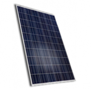
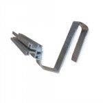
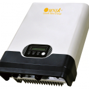


In the Summer of 2013, seven solar panels were installed on the  
house, unfortunately that was the maximum amount we were able to fit on  
the roof.

## Panels

Set of 7 ZN Shine poly-crystalline ZXP6 ALU modules 250Wp each total of  
1750Wp / 1575kWh.

## Mounting Material

They are mounted using Clickfit strips.

## Inverter

And are connected to an Omniksol 1.5 inverter 1750Wp incl. Wifi kit.

## Software

The Wifi kit sends the statistics to the [Omniksol portal](http://www.omnikportal.com/) and my Cubieboard2 using the code  
below to the [pvoutput.org](http://pvoutput.org) portal.  
[cyberjunky/Omnik-Data-Logger on GitHub](https://github.com/cyberjunky/Omnik-Data-Logger)

## Attachments

<https://www.zonnepanelen.net/nl/pdf/panels/ZXP6-60-235-255W_V1405_EN1_LQ.pdf>

