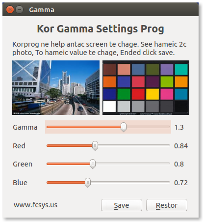




Install xgamma-gui:

```
    $ git clone https://github.com/dfc643/xgamma-gui.git
    $ cd xgamma-gui
```

Add to Makefile:

```
    CONFIG += qt
    QT += gui

    $ qmake && make && make install
    $ ./XgammaGui
```

